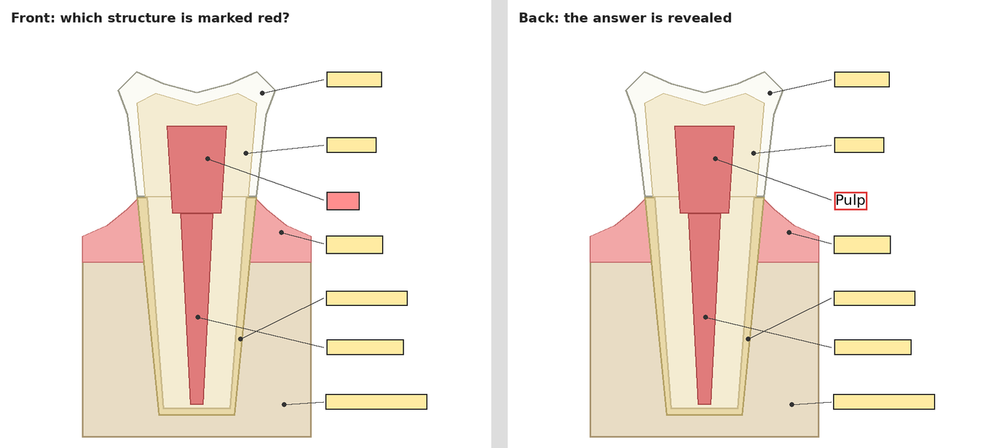

# AI Study Anki

A skill for **terminal AI agents** (AI coding agents / agentic CLIs such as Claude Code, Codex CLI, Gemini CLI, OpenCode …) that turns your study materials (PDFs, lecture notes, slides, even scans) into **Anki flashcards**. You get a ready-made Anki package (`.apkg`) with **basic cards, cloze cards and image occlusion cards** made from the figures in your materials. Double-click it, click *Import*, done.



*Illustration of an image occlusion card made from a labelled figure. Front: all labels are hidden, the red one is asked. Back: the answer is revealed.*

## What you get

- **Three card types in one package**:
  - **Basic**: question → short answer with the key statement in bold and a one-line *why*.
  - **Cloze**: a complete sentence with the key term as a gap (`{{c1::…}}`), one card per gap.
  - **Image occlusion**: the labels of a figure are found automatically with OCR and hidden; one card per label.
- **Good cards, not just many cards**: one piece of information per card, unambiguous questions with context, why cards, difference cards and optional case cards.
- **Variants, exceptions and numbers** from your materials are included, because exactly those get tested.
- **No duplicates on re-import**: the same card always gets the same ID. A newer package of the same material updates your existing cards and keeps your review progress.
- **Checked twice**: the script checks every card (empty fields, clozes without a gap, boxes outside the image, duplicates), draws the occlusion boxes onto a check image, and a reviewer pass compares every card with your sources.
- **Weak spots first**: if you used [ai-study-quiz](https://github.com/blackpaired/ai-study-quiz) or [ai-study-tutor](https://github.com/blackpaired/ai-study-tutor) before, the weak spots from their logs become cards first.
- **CSV on request** (basic cards only) for people who prefer it.
- **Automatic conversion** of your materials to Markdown (`to_md.sh`), including detection of scanned PDFs.

## Try the demo

The [`examples`](examples) folder contains a small demo deck about dental anatomy (with a figure drawn for this repo):

- [`demo.apkg`](examples/demo.apkg): download it and double-click it. You get 3 basic, 2 cloze and 1 image occlusion note (14 cards) in the deck *Demo::Dental anatomy*.
- [`cards.json`](examples/cards.json): the cards file the AI wrote for it. This is the format the AI produces.
- [`tooth.png`](examples/tooth.png): the figure used for the image occlusion card.

To build the package yourself: `python3 -I skills/study-anki/anki_package.py examples/cards.json demo.apkg`

## How it works

1. **Convert:** all files in your folder are converted to `.md` with `markitdown` (fallback: `pandoc` for Word files). For scanned pages, the AI looks at rendered page images directly or runs OCR.
2. **Ask:** up to 4 quick questions: scope, amount, card types and content.
3. **Write:** the AI writes the cards into a JSON file. For image occlusion, it renders the pages with figures, crops the figure and finds the labels with `find_labels.py` (Tesseract OCR).
4. **Check:** `anki_package.py --preview` checks the cards and draws every occlusion box onto a check image. A reviewer pass compares the cards with your sources, and justified corrections are applied.
5. **Build:** `<Material>_Anki.apkg` is created next to your materials.
6. **Import:** double-click the `.apkg` (or in Anki: *File → Import*) → *Import*.

## Card format (cards.json)

```json
{
  "deck": "Medicine::Anatomy::Muscles and nerves",
  "tags": ["anatomy"],
  "cards": [
    {"type": "basic", "front": "Which nerve supplies the deltoid?", "back": "<b>Axillary nerve</b>"},
    {"type": "cloze", "text": "The {{c1::axillary nerve}} passes through the {{c2::quadrangular space}}.", "extra": "Notes, section 3"},
    {"type": "occlusion", "image": "/path/figure.png", "header": "Shoulder, posterior view", "extra": "Notes p. 12",
     "mode": "all", "boxes": [{"left": 597, "top": 71, "width": 116, "height": 28}]}
  ]
}
```

- `mode: "all"`: all labels hidden, one is asked (default). `mode: "one"`: only the asked label is hidden.
- Boxes are in pixels of the image. `find_labels.py` prints them for every label it finds.
- The note types are called *study-anki: Basic*, *study-anki: Cloze* and *study-anki: Image Occlusion*. They are kept in a small template collection in the skill folder, so Anki recognises them on every import instead of creating duplicates.

## Requirements

- A terminal AI agent that can read files and run shell commands. Skill and subagent support is a plus, but not required. Image support (the AI can look at images) is needed for image occlusion cards.
- Linux or macOS (Windows via WSL)
- [Anki](https://apps.ankiweb.net) 23.10 or newer (built-in image occlusion)
- Python 3 with Anki's Python library and Pillow: `pip install anki pillow` (some Linux packages of Anki, e.g. on Arch, already include the library). Without it, only CSV works.
- [`markitdown`](https://github.com/microsoft/markitdown): `pipx install 'markitdown[all]'`
- `poppler`: `sudo pacman -S poppler` / `sudo apt install poppler-utils` / `brew install poppler`
- `tesseract` plus the language packs you need (for image occlusion and scans)
- Optional: [`pandoc`](https://pandoc.org) (fallback for Word files)

## Installation

```bash
git clone https://github.com/blackpaired/ai-study-anki.git
cd ai-study-anki
bash install.sh
```

By default the script copies the skill to `~/.claude/skills/study-anki/`, a folder several AI tools read skills from (`SKILL.md` is an open format used by many AI agents). If your AI tool loads skills from a different folder, pass it:

```bash
bash install.sh ~/.my-ai-tool/skills
```

The script also shows which required programs are missing. Updating with `install.sh` keeps the template collection, so your note types stay the same.

To install by hand instead:

```bash
mkdir -p <skills-folder>
cp -r skills/study-anki <skills-folder>/
chmod +x <skills-folder>/study-anki/*.sh <skills-folder>/study-anki/*.py
```

Then restart your AI agent.

**Tool without skill support?** It still works: tell the AI *"follow the instructions in `<skills-folder>/study-anki/SKILL.md` for ~/Documents/Physiology/"*.

## Use in AI chat apps

Some AI chat apps (web or desktop) let you upload skills in the `SKILL.md` format as a ZIP file:

1. Download **`study-anki.zip`** from the [latest release](https://github.com/blackpaired/ai-study-anki/releases/latest).
2. Upload it in your app's skill settings.
3. Make sure the app lets the AI run code and create files.
4. Upload your lecture notes in a chat and ask, e.g., *"make Anki cards from these notes, with cloze and image occlusion"*.

You download the finished `.apkg` and import it in the Anki app on your computer. If OCR isn't available there, the AI places the image occlusion boxes by looking at the figure and checks them on the check images.

Some apps allow only 200 characters for a skill description, so the ZIP has a shorter one. To build the ZIP yourself: `bash package_zip.sh` (creates `dist/study-anki.zip`).

## Usage

Put the materials for one exam into one folder, then in your AI agent type:

```
/study-anki ~/Documents/Physiology/
```

Plain language works too: *"make Anki cards from ~/Documents/Physiology"*, or *"Anki cards only for chapter 3, with image occlusion for the figures"*.

Some useful follow-ups:

- "add more cards for chapter 5"
- "make image occlusion cards for the figures on pages 12–15"
- "make the answers shorter"
- "give me a CSV instead"

## Works well with

- [ai-study-notes](https://github.com/blackpaired/ai-study-notes): study notes that explain the connections, exported as a PDF.
- [ai-study-tutor](https://github.com/blackpaired/ai-study-tutor): teaches you the material step by step.
- [ai-study-quiz](https://github.com/blackpaired/ai-study-quiz): quizzes you like an oral examiner.

## Important

- Facts come from your materials. Reasoning and mnemonics partly come from general knowledge. **If anything contradicts your lecture or textbook, your lecture wins.**
- The checks catch a lot, but not everything. If a card looks wrong, fix it in Anki or ask the AI.
- Figures from your lecture materials are for your own use. Don't share decks that contain them publicly.
- Every run uses your AI usage (tokens / plan limits). Large materials and many figures mean more usage.

---

*This repo was created with the help of Claude Opus 5.5.*
